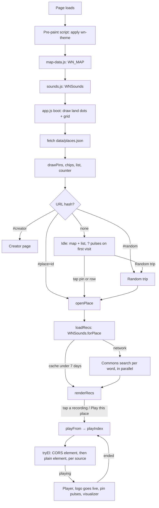
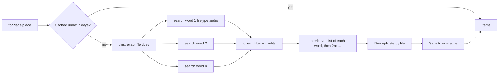
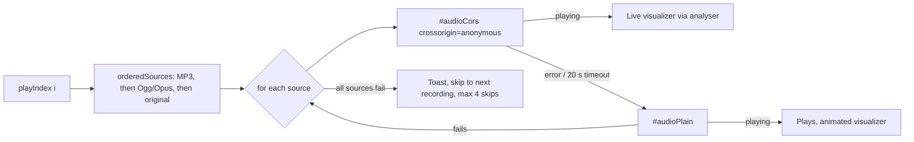

# W-Noise: project guide

This document explains how W-Noise works from end to end: what the app does, how the files are organised, how the code inside each file is structured, how a place on the map turns into real recordings with credits, how sound is played and visualised, and how to extend, test and deploy it.

For a short user-facing overview, see [README.md](README.md). For quick rules when editing with a coding agent, see [CLAUDE.md](CLAUDE.md).

*Created by **SSK-BLUM**.*

---

## 1. What W-Noise is

W-Noise ("World Noise") is an installable web app (PWA) that lets you travel the world by ear. A **spinning 3D globe** (or, at the tap of a button, a flat dotted map) shows 32 places: rainforests, savannas, oceans, waterfalls, ice, deserts, mountains and cities. Tap a place and W-Noise finds **real field recordings made at or near that location** on **Wikimedia Commons**, plays them, and credits every recordist with their name, licence and a link to the original file. All credits are gathered on the **Creator page**, which also shows *Created by SSK-BLUM*.

| | |
| --- | --- |
| **Type** | Static single-page web app, installable as a PWA |
| **Languages** | HTML, CSS, vanilla JavaScript (ES2020) |
| **Build step** | None. Files are served as they are (the map is pre-generated once by `tools/build-map.mjs`) |
| **Bundled libraries** | None |
| **Loaded at runtime** | Google Fonts (Unbounded, DM Sans, JetBrains Mono) |
| **Sound data** | Wikimedia Commons, through the MediaWiki API (`commons.wikimedia.org/w/api.php`, CORS with `origin=*`) |
| **Map data** | Natural Earth land (public domain) via `world-atlas`, converted to ~3,300 dots in `map-data.js` |
| **Audio** | Two `<audio>` elements, Web Audio API analyser for the visualizer, Media Session API for lock-screen controls |
| **Storage** | `localStorage` only (theme, saved places, volume, loop, recording lists for 7 days, listening log) |
| **Offline** | Service worker caches the app shell, map and place list; sounds need a connection |
| **Hosting** | Any static host over HTTPS. GitHub Pages workflow included |
| **Accounts / tracking / API keys** | None |

---

## 2. Repository structure

```
w-noise/
├── index.html              Markup: header with animated logo, map, panel, player, Creator page, dialogs, spotlight, icon sprite (~275 lines)
├── styles.css              Tokens, dark/light themes, logo animation, map, panel, player, pages, mobile layout, motion (~335 lines)
├── app.js                  The whole UI in one IIFE (~890 lines)
├── sounds.js               Wikimedia Commons search, filtering, credits and cache: window.WNSounds (~175 lines)
├── photos.js               Wikimedia Commons place photos, filtering, credits and cache: window.WNPhotos
├── map-data.js             Generated: window.WN_MAP, the dotted world land path (equirectangular 1000×500)
├── data/
│   └── places.json         The 32 places: name, country, coordinates, category, blurb, search words, pinned files
├── sw.js                   Service worker: offline shell and caching rules
├── manifest.webmanifest    PWA manifest: name, colours, icons, shortcuts (Random trip, Creator)
├── icons/
│   ├── icon.svg                     Vector icon (favicon)
│   ├── icon-192.png, icon-512.png   App icons
│   ├── maskable-512.png             Android adaptive icon
│   └── apple-touch-icon.png         iOS home-screen icon (180×180)
├── tools/
│   ├── build-map.mjs       Regenerates map-data.js from Natural Earth (dev only, needs npm packages)
│   └── build-single.mjs    Builds dist/w-noise.html: the whole app in one file (dev only, no packages)
├── docs/
│   └── screenshots/        README images (phone, web, help, creator, credit)
├── .github/
│   └── workflows/
│       └── pages.yml       GitHub Actions: publish the folder to GitHub Pages on push to main
├── .nojekyll               Serve files as they are on GitHub Pages
├── .gitignore
├── .gitattributes          LF line endings; map-data.js marked as generated
├── LICENSE                 MIT © SSK-BLUM (code only; recordings keep their own licences)
├── README.md               User-facing overview, screenshots, services, run and deploy steps
├── CHANGELOG.md            What changed in each version
├── CLAUDE.md               Short rules for coding agents
└── PROJECT.md              This document
```

Script load order in `index.html`: inline pre-paint script (in `<head>`) → `map-data.js` → `sounds.js` → `photos.js` → `app.js` (at the end of `<body>`). `sounds.js` defines `window.WNSounds` and `photos.js` defines `window.WNPhotos`; `app.js` uses it and exposes `window.WNoise` for tests and the console.

---

## 3. Features at a glance

| Area | What the user can do |
| --- | --- |
| **Globe and map** | A 3D globe that spins by itself (7° per second) with glowing, pulsing location spots; drag to turn it, pinch or scroll to zoom, +/−/re-centre buttons. Tap a spot to open the place; the globe turns to it and holds. A button (or key `g`) switches to the flat dotted map (drag, pinch, scroll). The playing place pulses amber with its name shown in both views |
| **Places list** | Search (name, country, description, search words), category chips with counts (All, ★ Saved, Forests, Wildlife, Water, Cities, Weather, Mountains, Ice, Deserts, Culture), coordinates, "ON AIR" badge |
| **Place page** | Category, coordinates, description, **Play this place**, **Refresh** (search Commons again), ☆ Save, the list of real recordings with recordist, licence and length, **Find more recordings** |
| **Random trip** | Picks a random place (within the current filter) and starts playing |
| **Player** | Play/pause, previous/next recording, seek bar, loop, sleep timer (15/30/60/90 min with fade-out), credit (ⓘ), volume, live spectrum visualizer, lock-screen controls |
| **Creator page** | Created by SSK-BLUM, version and stats, every recording credited by place (title, recordist, licence, length, date, link), "♪ heard" marks, **Collect credits for all places**, **Copy as text**, map/font/code credits, clear saved lists |
| **Header** | **Animated logo** (opens the Creator page), counter, Install, ♡ Creator, theme switch (Auto → Light → Dark), **Screen mode** (Auto → Mobile → Tab → Web), **?** How to use, 🎨 **Colour palettes** |
| **Help** | Guide to every control with **Show me** spotlight, and a 10-step tour |
| **Place picture** | Animated per-category SVG scene in the place panel, real credited Commons photos fading in as a Ken Burns slideshow, tap for a full-screen view above the player, photo credits on the Creator page |

---

## 4. How the code is organised

### 4.1 `app.js`

One IIFE (`(() => { 'use strict'; … })()`). Sections in order (line numbers are approximate):

| Line | Section | What it contains |
| --- | --- | --- |
| 11 | **1. Helpers** | `$`, `$$`, `store` (try/catch `localStorage`), `esc`, `fmtTime`, `fmtCoord`, `isMobile`, `reduced`, `toast`, `ico`, `CATS` (category labels and emoji); then the `state` object (see §6.1) |
| 57 | **2. Theme** | `THEMES` (auto, light, dark), `applyTheme()` (sets `data-theme`, icon and label), theme button; `PALETTES`, `applyPalette()`, the palette picker |
| 73 | **3. Data** | `loadPlaces()` (fetches `data/places.json`, builds `byId`), `updateCounter()` |
| 87 | **4. Map** (flat view) | Projection `proj(lon, lat)`, `drawMapBase()` (land dots + 30° grid), `drawPins()`, `unitsPerPx()`, `scalePins()` (keeps pins the same size on screen at any zoom), `markPins()` (dim / selected / live / label), `setVB()` (viewBox with clamping), `toMap()`, `zoomAt()`, `flyTo()` (eased camera move), `nearestPin()` (tap picking), pointer pan / pinch / tap, wheel zoom, zoom buttons |
| 4b | **4b. Globe** | Canvas globe: `G` state, `globePoints()` (land dots parsed from `map-data.js`), `drawGlobe()` (glow, sphere, graticule, dots, shading, spots, labels), `globeFrame()` (spin, tween, draw loop), `globeTo()`, drag/pinch/wheel/tap, `gPick()`, `setView()` |
| 249 | **5. List** | `visiblePlaces()` (category + search filter), `renderChips()`, `renderList()`, chip, search and row handlers |
| 287 | **6. Place view** | `showView()`, `openPlace()`, `loadRecs()` (skeletons → `WNSounds.forPlace`), `renderRecs()`, Find more, Refresh, Play this place, Back, Save, Random trip |
| 400 | **7. Audio** | Two elements (`#audioCors`, `#audioPlain`), `initAudioGraph()` (analyser), `orderedSources()`, `playFrom()`, `playIndex()`, `tryEl()`, `togglePlay()`, `setPlaying()`, `showNowPlaying()` (+ Media Session metadata), element events, next/prev/seek/volume, loop, sleep timer, Media Session actions, `logHeard()` |
| 588 | **8. Visualizer** | `startViz()`, `drawViz()` on `<canvas id="viz">` behind the player |
| 617 | **9. Creator page** | `openPage()` / `closePage()`, `openCreator()`, `renderCreator()` (clones the animated logo, groups credits by place), Collect credits (3 places at a time), Copy as text, Clear |
| 683 | **10. Credit dialog** | `openModal()` / `closeModal()`, `[data-close]` handling, the ⓘ dialog for the current recording |
| 715 | **11. Help, Show me & tour** | `HELP` (22 items in 5 sections), `TOUR` (10 steps), `renderHelp()`, `prepareStep()`, `showStep()`, `placeSpot()`, `backToGuide()`, `nextTour()` |
| 814 | **12. Mobile sheet** | `setSheet()` (normal / big map / hidden map), handle tap and swipe |
| 836 | **13. PWA, keyboard, routing, boot** | Install prompt, service-worker registration, keyboard shortcuts, `route()` (`#place=`, `#creator`, `#random`), `boot()` |

### 4.2 `sounds.js`

One IIFE that defines `window.WNSounds = { forPlace, pick, cached, allCached, clearCache, save, API }`.

| Part | What it does |
| --- | --- |
| Constants | `API`, cache key `wn-cache`, 7-day cache life, `MIN_SEC` (8 s), `MAX_SEC` (3 h), `SKIP_TITLE` (pronunciation files, Lingua Libre `LL-Q…`, spoken word, anthems, MIDI), `FREE` (accepted licence names) |
| `getJSON()` | `fetch` with a 12 s timeout and abort |
| `searchURL(term, offset)` | `generator=search` in the File namespace (`gsrnamespace=6`) with `gsrsearch="<term> filetype:audio"`, 12 results, `prop=videoinfo` with `url|size|mime|mediatype|derivatives|extmetadata` |
| `titlesURL(titles)` | The same details for exact file names (curated "pins") |
| `toItem(page, term)` | Turns one Commons page into a W-Noise item (§7.2), or `null` if it is not audio, too short/long, spoken word or has no free licence |
| `pick(item)` | First source the browser can play: MP3 transcode → Ogg/Opus → original |
| `forPlace(place, opts)` | The search (§7.1); returns `{ items, offset, more, errors, fromCache? }` |
| Cache | `cached(id)`, `save(id, entry)`, `allCached()`, `clearCache()` |

### 4.3 Other files

- **`index.html`**: `<head>` (meta, two `theme-color` tags, manifest, icons, fonts, stylesheet, pre-paint theme script), header (logo button, counter, Install, ♡, theme, ?), map section (SVG with sea, grid, land path and pins; hint; zoom buttons; Random trip), panel (`#viewList`, `#viewPlace`), player (canvas, info, controls, extras, progress), Creator page, Help dialog, Credit dialog, spotlight, toast, two `<audio>` elements, SVG icon sprite (`#i-*`), scripts.
- **`map-data.js`**: one generated line, `window.WN_MAP = { w, h, step, d }`, where `d` is a path of zero-length segments (`M x y h0`) drawn as round dots with `stroke-linecap: round`. One element for the whole map keeps it fast.
- **`tools/build-map.mjs`**: samples a 7 px grid over an equirectangular 1000×500 world and keeps the points inside Natural Earth land (`d3-geo` `geoContains`).
- **`styles.css`**: see §11. **`sw.js`**: see §13.

---

## 5. Runtime flow



### Boot order

1. The inline script in `<head>` reads `wn-theme` and sets `data-theme` before anything paints, so there is no flash of the wrong theme.
2. `map-data.js` and `sounds.js` register their globals.
3. `app.js` applies the theme, draws the land dots and grid, restores the last category (`wn-cat`), loads `data/places.json` (a retry button appears if it fails), draws the pins, chips and list, sets the full-world view, adds the pulsing ring to **?** on the first visit, then reads the hash with `route()`.

### Views and routing

The map, panel and player are always on screen. The panel shows either the **list** (`#viewList`) or one **place** (`#viewPlace`). The Creator page, Help and Credit dialogs open over everything.

| Hash | What opens |
| --- | --- |
| *(none)* | Map and list |
| `#place=<id>` | That place (a reload or shared link reopens it) |
| `#creator` | Creator page |
| `#random` | A random trip (used by the manifest shortcut) |

Hashes are set with `history.replaceState`, so the browser's Back button leaves the app instead of stepping through every place.

---

## 6. Places and the map

### 6.1 State

`state` holds: `places`, `byId`, `cat` (category filter), `q` (search text), `place` (place open in the panel), `recs` / `recOffset` / `recMore` (its recordings and paging), `queue` / `queuePlace` / `idx` (what the player is playing from; this can differ from the open place), `playing`, `loop`, `saved` (Set of place ids), `heard` (listening log).

### 6.2 `data/places.json`

```json
{
  "id": "amazon",
  "name": "Amazon Rainforest",
  "country": "Brazil",
  "cc": "BR",
  "lat": -3.4, "lon": -62.2,
  "cat": "forest",
  "blurb": "Howler monkeys, frogs, insects and rain in the world's largest tropical forest.",
  "q": ["Amazon rainforest", "rainforest Brazil ambience", "howler monkey", "Amazon frogs"],
  "pins": []
}
```

- `cat` is one of `forest`, `wildlife`, `water`, `city`, `weather`, `mountain`, `ice`, `desert`, `culture` (see `CATS` in `app.js`).
- `q` is the list of Wikimedia Commons search words for this place. Each word is searched separately.
- `pins` is an optional list of exact Commons file names (`"File:Something.ogg"`) that always appear first. Use it to hand-pick the best recordings for a place.

The 32 places: Amazon, Monteverde, Borneo, Congo, Black Forest, Daintree, Serengeti, Okavango, Sahara, Souq Waqif (Doha), Jemaa el-Fnaa, Kerala monsoon, Mumbai, Himalaya, Tokyo, Kyoto, Beijing, Venice, London, Paris, Swiss Alps, Iceland, Arctic, Antarctica, New York, Niagara, Yellowstone, Florida storm, Hawaii, Great Barrier Reef, Rio de Janeiro, Patagonia (25 countries).

### 6.3 Map drawing

- **Projection**: equirectangular, `x = (lon + 180) / 360 × 1000`, `y = (90 − lat) / 180 × 500`. It is simple enough that adding a place needs only its latitude and longitude.
- **Land**: one `<path id="land">` from `WN_MAP.d`, stroked with `--land` and round caps so every segment is a dot. A faint 30° grid sits behind it.
- **Pins**: one `<g class="pin">` per place with a glow, two pulse rings, the dot and a label. `scalePins()` resizes them from `unitsPerPx()` so they stay about 11 px wide at any zoom.
- **States**: `.dim` (filtered out), `.sel` (open in the panel, name shown), `.live` (playing: amber dot, pulsing rings, name shown).

### 6.4 Pan, zoom and tap

The camera is the SVG `viewBox`, always 2:1. `setVB()` clamps width between 1/12 and the whole world and keeps at least 30% of the map in view.

- **Drag** (one pointer): moves the viewBox by the pointer delta × `unitsPerPx()`.
- **Pinch** (two pointers): scales around the midpoint.
- **Wheel**: zooms ×1.18 around the cursor.
- **Tap**: a pointer that moved less than 6 px. `nearestPin()` converts the point to map units with `toMap()` and picks the closest pin within 22 px (filtered-out pins are slightly harder to hit). Merged hit-testing like this is more forgiving on phones than tiny SVG targets.
- **`flyTo(lon, lat, zoom)`**: an 800 ms ease-out camera move, used when a place opens (zoom 3.2) and by the globe button (zoom 1). It jumps instantly with reduced motion.

### 6.5 Globe view

The default view is a canvas globe (`<canvas id="globe">`) drawn from the **same land dots** as the flat map, so no extra data is loaded.

- **Projection**: orthographic. For a point at longitude λ, latitude φ and view centre (λ0, φ0): `cos c = sin φ0 sin φ + cos φ0 cos φ cos(λ−λ0)`; it is on the near side when `cos c > 0`; `x = R cos φ sin(λ−λ0)`, `y = R (cos φ0 sin φ − sin φ0 cos φ cos(λ−λ0))`. `globePoints()` parses `WN_MAP.d` once into `[lon, sinLat, cosLat]` triples.
- **Drawing order** each frame: teal atmosphere glow → ocean sphere (radial gradient) → 30° graticule → land dots (four brightness buckets; dots shrink and fade toward the edge) → edge shading → location spots → labels.
- **Spots**: a soft halo, a slowly expanding ring (offset per place so they twinkle), and a centre dot with a teal rim. The **selected** place has an extra ring and its name; the **playing** place turns amber with two fast rings and its name. Places hidden by the category/search filter fade to 22%. Spots near the edge fade out.
- **Spin**: `SPIN = 7` degrees per second. It pauses while dragging, for 2.5 s after a drag, and while a place is open (the globe holds on it); it resumes when you go back to the list. With `prefers-reduced-motion` the globe does not spin, glide or pulse.
- **Opening a place**: `flyTo()` hands over to `globeTo(lon, lat, 1.35)`, a 1.1 s ease-out turn by the shortest way round, tilted to the place's latitude (clamped ±55°).
- **Interaction**: dragging turns the globe (1 px of drag = 1 px of surface at the centre; tilt limited to ±80°); two fingers or the wheel zoom (0.6× to 3×); a tap picks the nearest spot within 24 px (`gPick()` uses the spot positions from the last frame); on desktop, hovering a spot shows its name. The re-centre button resets tilt and zoom and keeps spinning.
- **Switching**: `setView('globe' | 'flat')` sets `body[data-view]` (CSS shows the canvas or the SVG), saves `wn-view`, updates the button icon, labels and hint, and re-centres the other view on the open place. The draw loop stops in the flat view and when the tab is hidden.
- **Performance**: about 3,300 dots in four batched `Path2D` fills plus 32 spots per frame, at device pixel ratio up to 2.

---

## 7. Finding real sounds (Wikimedia Commons)

### 7.1 The search



1. If `wn-cache` has a list for the place younger than 7 days, it is returned at once (`fromCache`).
2. Curated `pins` are fetched by exact title.
3. Every word in `q` is searched **in parallel**: `generator=search`, File namespace, `"<word> filetype:audio"`, 12 results, with `videoinfo` details. One failing word never empties the list.
4. Each result goes through `toItem()`. Results are then **interleaved** (first result of each word, then the second…) so a place gets a mix of, say, rain, frogs and monkeys, instead of twelve recordings of one thing.
5. Duplicates are removed by file name and the list is saved.
6. **Find more recordings** asks for the next 12 per word (`gsroffset`), appends new files and updates the cache. **Refresh** ignores the cache.

### 7.2 One item shape

```js
{
  id: 'File:Rainforest_ambience.ogg',  // unique: the Commons file title
  title: 'Rainforest ambience',         // readable name
  file: 'File:Rainforest_ambience.ogg',
  page: 'https://commons.wikimedia.org/wiki/File:…',  // original file page
  author: 'Jane Doe', authorUrl: 'https://…',         // recordist (from Artist)
  license: 'CC BY-SA 4.0', licenseUrl: 'https://…',   // from LicenseShortName / LicenseUrl
  desc: '…', date: '2019-05-01',                       // ImageDescription, DateTimeOriginal (plain text)
  duration: 184, size: 2950000,
  srcs: [{ src, type }, …],                            // transcodes (MP3, Ogg…) + original
  term: 'Amazon rainforest'                            // which search word found it
}
```

HTML in Commons metadata (author links, descriptions) is turned into plain text with `DOMParser`; the first link in `Artist` becomes `authorUrl`.

### 7.3 Filters

| Rule | Why |
| --- | --- |
| `mediatype` must be `AUDIO`, not MIDI | Only real recordings |
| Length 8 s to 3 h | Skip blips and multi-hour uploads |
| Title must not match `SKIP_TITLE` | Place names also match pronunciation files (`En-…`, `LL-Q…`), spoken Wikipedia, interviews and anthems |
| Licence must match `FREE` (CC0, public domain, CC BY, CC BY-SA, GFDL, FAL, OGL) | Everything shown can be credited and reused |

### 7.4 Credits

Credits are built from the same data, so they are always the live values on Commons. If a recordist edits their file page, W-Noise shows the change after the 7-day cache (or immediately after **Refresh**). Credits appear in three places:

1. **Recording rows** on the place page (title, "by …", licence, length).
2. The **ⓘ Credit dialog** in the player: place, recordist (linked), licence (linked), recording date, length, original file link, search word, description, and whether the visualizer is live.
3. The **Creator page** (§10).

---

## 8. Playback

### 8.1 Two audio elements



- `#audioCors` is connected to a Web Audio `AnalyserNode` (created on the first play, inside the user's tap). Wikimedia's upload server allows CORS, so the visualizer usually shows the real spectrum.
- If a source refuses CORS, `#audioPlain` plays it without the analyser (a CORS-connected element would play silence).
- `orderedSources()` sorts sources MP3 → Ogg/Opus → original and drops any the browser says it can't play (`canPlayType`). Commons' MP3 transcodes make recordings play on iPhone, where Ogg Vorbis may not.
- A **play token** (`playTok`) cancels stale attempts when the user switches quickly.
- At the end of a recording, the next one in the queue plays (wrapping round), unless **Loop** is on.

### 8.2 Player controls

| Control | Behaviour |
| --- | --- |
| Play / pause | Starts the open place (or a random trip) if nothing has played yet. Space bar too |
| Previous | Restarts the recording if past 5 s, otherwise the previous one |
| Next | Next recording, or a random trip if nothing is queued. Key `n` |
| Seek | Range 0–1000 mapped to the duration |
| Loop | Sets `loop` on both elements; saved as `wn-loop` |
| Sleep | Cycles off → 15 → 30 → 60 → 90 min. At the end, an 8-second fade, then pause; the label shows minutes left |
| ⓘ Credit | Opens the credit dialog |
| Volume | Applies to both elements; saved as `wn-vol` |
| Lock screen | Media Session: title, recordist, place, app icon artwork; play, pause, next, previous |

### 8.3 Visualizer

`drawViz()` paints bars on the canvas behind the player at device pixel ratio (max 2). With the analyser it reads `getByteFrequencyData` (FFT 256, lower 70% of bins). Without it, it draws a gentle moving wave so the player still feels alive. It stops when paused and does not run with reduced motion.

### 8.4 Animated logo

The header logo is inline SVG: a globe with spinning meridians (`scaleX` flip animation), three sound rings expanding outward, and a three-bar equaliser. When sound plays, `#logo` gets `.live`: rings and bars turn amber and speed up. The Creator page shows a clone of the same logo. Reduced motion hides the rings and stops the animation.

---

## 9. Panel views

- **List**: search box, category chips (counts; Saved and All always shown), rows with emoji badge, name, ★ if saved, country and description, coordinates, and "ON AIR" for the playing place.
- **Place**: back, category and coordinates, name, country, ☆ save (`aria-pressed`), description, Play this place, Refresh, status line, recording rows (play button turns amber when playing), Find more, and a note about where recordings come from.
- Skeleton rows shimmer while Commons answers. Errors appear in the status line in red.

---

## 9a. Screen mode

Section 2 of `app.js` (`LAYOUTS`, `applyLayout()`) and the "screen mode" block in `styles.css`. The button (`#layoutBtn`, key `v`) cycles Auto → Mobile → Tab → Web and stores `wn-layout`.

- Every `@media (max-width: Npx)` rule is collected at boot; a forced mode re-points each rule's `media.mediaText` to `all` / `not all` using a virtual width (Mobile 390, Tab 834, Web 1280). Auto restores the original text. `prefers-*` queries are untouched. `isMobile()` follows the forced mode.
- On a wider real screen, Mobile and Tab show the app in a centred column (430 / 834 px, `html[data-layout]`); `transform: translateZ(0)` on `body` keeps `position:fixed` layers inside it.
- On a screen narrower than Tab/Web the viewport meta is switched to `width=834` / `width=1280` so the browser scales the page down.
- Changing mode resets the map sheet and fires a `resize` so the globe, picture and spotlight redraw.

---

## 9b. Place picture

Section 6b of `app.js` and `photos.js`.

- **Illustration (always works)**: `SCENES` holds nine generators (forest, wildlife, water, city, weather, mountain, ice, desert, culture), one per place category. `sceneSVG(place, aspect)` builds an SVG with a seeded random generator (mulberry32 of the place id), so each place always looks the same. Animations are CSS keyframes (`.sw .dr .tw .ff .fl .snow .rs .wv .car .pulse .aur .fa .fa2 .shoot`), switched off by `prefers-reduced-motion`. Tall boxes (phones) get extra sky above and a slight zoom so the landscape stays visible.
- **Photos (optional layer)**: `WNPhotos.forPlace(place)` searches Commons with the place's `ph` words (`data/places.json`), keeps free-licensed JPEG/WebP images at least 1000×550 with a 1.25–2.4 width/height ratio, skips maps/flags/diagrams by title, interleaves search terms, returns up to 10 and caches non-empty results in `wn-img-cache` for 7 days. It never throws. `mountScene()` fades each photo in over the illustration (Ken Burns, 8 s slideshow); a photo that fails to load is dropped. Each photo shows `Photo: author · licence` linking to its Commons page.
- **Views**: the hero in the place panel (`#hero`) and a full-screen `#stage` between header and player (`openStage()` / `closeStage()`; Esc or ✕ closes, tap advances the photo). The stage is redrawn when the phone is rotated.
- **Credits**: the Creator page lists every photo used (`renderPhotoCredits()`); *Collect credits* and *Copy as text* include photos.

---

## 10. Creator page

Opened by the logo, the ♡ button or `#creator`.

| Part | Content |
| --- | --- |
| Creator card | Animated logo, **Created by SSK-BLUM**, version, place count, number of credited sounds, installed or web |
| Intro | What W-Noise is and that every sound is a real, free-licensed field recording |
| Sound credits | One card per place that has recordings loaded; each recording: title (links to its Commons page), recordist (linked), licence (linked), length, date, "Wikimedia Commons", and **♪ heard** if you played it |
| Collect credits for all places | Loads the recording list of every place (3 at a time) so the page credits everything the app can play |
| Copy as text | Copies all credits as a Markdown-style list, ready for a README or video description |
| Map, code and fonts | Wikimedia Commons, Natural Earth / world-atlas, Google Fonts, and the app's own MIT licence |
| Clear saved sound lists | Empties `wn-cache` |

---

## 11. Interface and styling

### 11.1 Layout

| Width | Layout |
| --- | --- |
| > 1100 px | Grid: header across; map left; 400 px panel right; player across the bottom |
| 761–1100 px | Same with a 340 px panel |
| ≤ 760 px (phones) | Header, map (38% of the screen), rounded bottom sheet with the list, player (two rows) at the bottom. The sheet handle cycles map **normal → big (62%) → hidden**, or swipe it up/down. Dialogs become bottom sheets |
| ≤ 360 px | The previous button hides so the player fits at 320 px |

`env(safe-area-inset-*)` keeps the header and player clear of notches and home bars. The page never scrolls sideways (checked at 320 px).

### 11.2 Theme

- **Tokens** on `:root` (dark first): `--bg`, `--bg-2`, `--surface`, `--surface-solid`, `--surface-2`, `--line`, `--line-2`, `--fg`, `--muted`, `--accent` (signal teal `#4ee6c3`), `--accent-ink`, `--accent-soft`, `--live` (amber `#ffb547` for "playing"), `--live-soft`, `--sea`, `--land`, `--grid`, `--scrim`, `--shadow`, fonts `--f-display` (Unbounded), `--f-body` (DM Sans), `--f-mono` (JetBrains Mono), radii, `--gutter`, `--top-h`, `--player-h`, `--panel-w`, `--tap`.
- **Light theme** ("paper": warm off-white, sand-coloured land, deep teal accent) under `@media (prefers-color-scheme: light)` when no explicit theme is set, and under `:root[data-theme="light"]`.
- **Colour palettes** (🎨 button after **?**, opens a popover so you see the colours change live). The colours of every palette live in `styles.css`, in `[data-palette="…"]` rules that set only six variables: `--pa-d` / `--pa-l` (accent in dark / light), `--pk-d` / `--pk-l` (text on accent buttons), `--pv-d` / `--pv-l` (the amber "playing" colour). The theme blocks then choose: `--accent: var(--pa-d)` in dark, `var(--pa-l)` in light, with `--accent-soft` and `--live-soft` made by `color-mix()`. Palettes: **Aurora** (default teal), **Violet Night**, **Sunset**, **Ocean**, **Forest**, **Rose**, **Sand Gold**, **Mono Ice**. The choice is saved as `wn-palette`, set on `<html data-palette>` by the pre-paint script (no flash), and works with Auto/Light/Dark. The globe and visualizer read `--accent` from CSS, so they follow it. Light-mode values were checked for at least 4.5:1 text contrast on the paper background. To add a palette: add one `[data-palette="id"]` line in `styles.css` and one `{ id, name }` entry in `PALETTES` in `app.js`.
- **Theme button** cycles Auto → Light → Dark; the icon changes (half circle, sun, moon) and the choice is saved as `wn-theme`.

### 11.3 Components and accessibility

Glass map overlays, pill buttons, chips with `aria-selected`, recording rows, round play button with a breathing "loading" state, modals and bottom sheets, spotlight. Accessibility: skip link, visible focus rings, labelled icon buttons, `aria-live` on lists, status and toast, `aria-pressed` on Loop, Sleep and Save, dialogs with `aria-modal` and focus return, Esc closes everything, and `prefers-reduced-motion` support.

### 11.4 How to use (?) — guide, Show me and tour

`HELP` holds 22 items `{ sec, id, icon, title, text, target, prep?, optional?, when? }` in five sections: Start, Top bar, A place, Player, Tips. **Show me** closes the guide, runs `prepareStep()` (opens the list or a place if needed, restores the map on phones), scrolls the target into view and draws a spotlight: a hole made with a huge `box-shadow` and a pulsing outline, plus a tip card kept on screen. **Back to guide** returns to the same scroll position. **Take the 1-minute tour** runs the 10 `TOUR` steps (map, globe/flat switch, Random trip, categories, place picture, recordings, play, loop, credit, logo). The **?** button pulses until the guide has been opened once (`wn-seen-help`).

### 11.5 Keyboard

| Key | Action |
| --- | --- |
| Space | Play / pause |
| `n` | Next recording |
| `r` | Random trip |
| `g` | Switch globe / flat map |
| `/` | Focus search |
| `?` | Open the guide |
| Esc | Close the spotlight, a dialog, the Creator page, or the place view |

---

## 12. Persistence (`localStorage`)

| Key | Value | Meaning |
| --- | --- | --- |
| `wn-theme` | `"auto"` / `"light"` / `"dark"` | Appearance |
| `wn-cat` | category key | Last category chip |
| `wn-palette` | palette id (`"aurora"`, `"violet"`, …) | Colour palette |
| `wn-view` | `"globe"` / `"flat"` | Map view (globe is the default) |
| `wn-saved` | array of place ids | ★ Saved places |
| `wn-vol` | `0`–`1` | Volume |
| `wn-loop` | boolean | Loop on/off |
| `wn-cache` | `{ placeId: { t, items, offset, more } }` | Recording lists with credits, kept 7 days |
| `wn-layout` | `auto` / `mobile` / `tab` / `web` | Screen mode |
| `wn-img-cache` | `{ placeId: { t, items } }` | Photo lists with credits, kept 7 days |
| `wn-heard` | `{ file: { placeId, t } }` | Recordings you played (♪ heard on the Creator page) |
| `wn-seen-help` | boolean | First-visit guide nudge done |

All values are JSON. All access goes through `store.get/set`, wrapped in try/catch, so private browsing or blocked storage never breaks the app. Nothing leaves the device except the Commons API requests and the audio streams.

---

## 13. Progressive Web App and caching

- **`manifest.webmanifest`**: name "W-Noise — Sounds of the World", short name "W-Noise", `display: standalone`, `id`, `start_url` and `scope` `./` (works from a GitHub Pages sub-path), background/theme `#070b14`, SVG, 192, 512 and maskable icons, **shortcuts** (Random trip, Creator & credits).
- **`sw.js`** (cache `w-noise-v8`):
  - *Install*: pre-cache the shell (HTML, CSS, all scripts, `map-data.js`, `places.json`, manifest, icons).
  - *Activate*: delete older `w-noise-*` caches.
  - *Audio, range requests and `upload.wikimedia.org`*: never touched (streams are not cached).
  - *Commons API*: network only (`sounds.js` keeps its own 7-day list cache).
  - *Page navigations*: network first, cached `index.html` when offline.
  - *Google Fonts*: stale-while-revalidate.
  - *Own files*: cache first, then network.
- **Install**: `beforeinstallprompt` shows the header Install button; on iOS use Share → Add to Home Screen.
- **Offline**: the app opens, the map, list, saved places and credits work; playing needs a connection.

> Whenever a shipped file changes, bump `VERSION` in `sw.js` (for example `w-noise-v9`) so installed copies update.

---

## 14. Extending

| To add… | Do this |
| --- | --- |
| **A place** | Add an object to `data/places.json` with a unique `id`, `name`, `country`, `cc`, `lat`, `lon`, `cat`, `blurb` and 2–4 search words in `q`. It appears on the map, in the list, chips, search, Random trip and the Creator page automatically |
| **Better sounds for a place** | Find good recordings on commons.wikimedia.org and add their exact titles (`"File:….ogg"`) to `pins`. They always come first. Tune `q` words: specific words ("howler monkey") beat place names ("Brazil") |
| **A category** | Add `{ label, emoji }` to `CATS` in `app.js` and use the key as `cat` in places |
| **A filter rule** | Edit `SKIP_TITLE`, `FREE`, `MIN_SEC` or `MAX_SEC` in `sounds.js` |
| **Another sound source** | Write a function in `sounds.js` that returns items in the shape of §7.2 (the API must allow browser requests, and every item needs author, licence and page), and merge its results in `forPlace()` |
| **A help item** | Add to `HELP` (and `TOUR` if essential); test Show me on a phone and desktop |
| **A new map style** | Change the grid step in `tools/build-map.mjs` and rerun it (see §15) |

After any change: syntax-check, bump `sw.js` `VERSION`, test (§15), update README/PROJECT, commit.

---

## 15. Development, testing and deployment

### Run locally

```bash
python3 -m http.server 8080      # or: npx serve .
# open http://localhost:8080
```

Use `localhost` or HTTPS; the service worker and installation don't work from `file://`.

### Rebuild the map (only if you change it)

```bash
mkdir /tmp/mapb && cd /tmp/mapb && npm init -y && npm i world-atlas@2 topojson-client d3-geo
cp /path/to/w-noise/tools/build-map.mjs . && node build-map.mjs /path/to/w-noise/map-data.js
```

### Build one HTML file (optional)

```bash
node tools/build-single.mjs      # writes dist/w-noise.html (ignored by git)
```

It inlines `styles.css`, `map-data.js`, `sounds.js`, `photos.js`, `app.js`, `data/places.json` (as `window.WN_PLACES`) and the icon. `app.js` uses `WN_PLACES` when present and skips the service worker in that case. Sounds and fonts still load from the internet, and the single file can't be installed as a PWA.

### Checks used during development

- **Syntax**: `node --check app.js sounds.js photos.js sw.js map-data.js`, and parse `manifest.webmanifest` and `data/places.json` as JSON.
- **Headless UI tests** with Playwright (Chromium) at phone 390×844 (touch, dark), 320×640 (touch, dark) and desktop 1280×800 (light), with **Wikimedia Commons mocked** (search results with credits, a pronunciation file that must be filtered out, a test WAV served as the audio file). Checked: no page errors or console errors; a place opens with 16 interleaved recordings and the pronunciation file removed; Play this place starts playback, the logo goes live, the title updates; the credit dialog; every **Show me** item (Install is correctly reported as hidden when the browser doesn't offer it); the Creator page; **Collect credits for all places** loads 32 places (464 credited rows); no horizontal overflow at any size.
- **Real-world check**: open the deployed site, try a few places, open ⓘ on a recording and confirm the Commons page, author and licence match.

### Deploy

Push to `main`. `.github/workflows/pages.yml` publishes the repository root to GitHub Pages (needs **Settings → Pages → Source: GitHub Actions** once). The site is then at `https://<user>.github.io/<repo>/`.

---

## 16. Known limitations and ideas

- **Search accuracy**: recordings are found by search words, so a few results can be loosely related (for example a generic "thunder" recording made elsewhere). Use `pins` to hand-pick exact files for the places that matter most.
- **Coverage varies**: Commons has many nature and wildlife recordings but fewer city soundscapes for some places. Places with few results show a friendly message and Refresh.
- **Commons availability**: if Wikimedia is slow or down, cached lists still work for 7 days; otherwise the place shows an error and can be retried.
- **iPhone**: playback relies on Commons' MP3 transcodes; a file with no transcode may not play and is skipped automatically.
- **Background play** on phones depends on the browser; installed PWAs and lock-screen controls help.
- **Saved places and history are per device**; no sync.
- **No automated test suite** in the repository yet; the Playwright checks above were run by hand.
- **Ideas**: a sound **mixer** (layer rain over a city), a 3D globe mode, "now in daylight / night" shading, recording location pins from Commons coordinates (`prop=coordinates`), Freesound as an optional keyed source, offline download of favourite recordings, more places (user suggestions), and translations.
