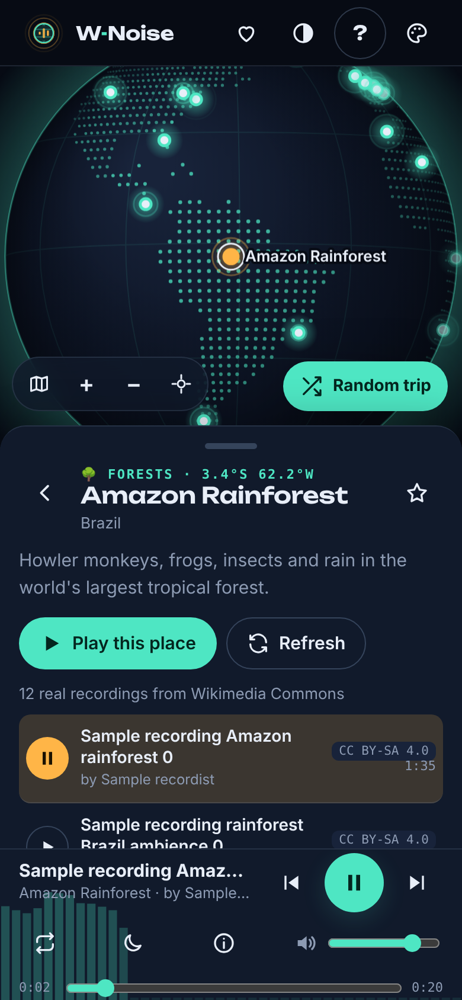
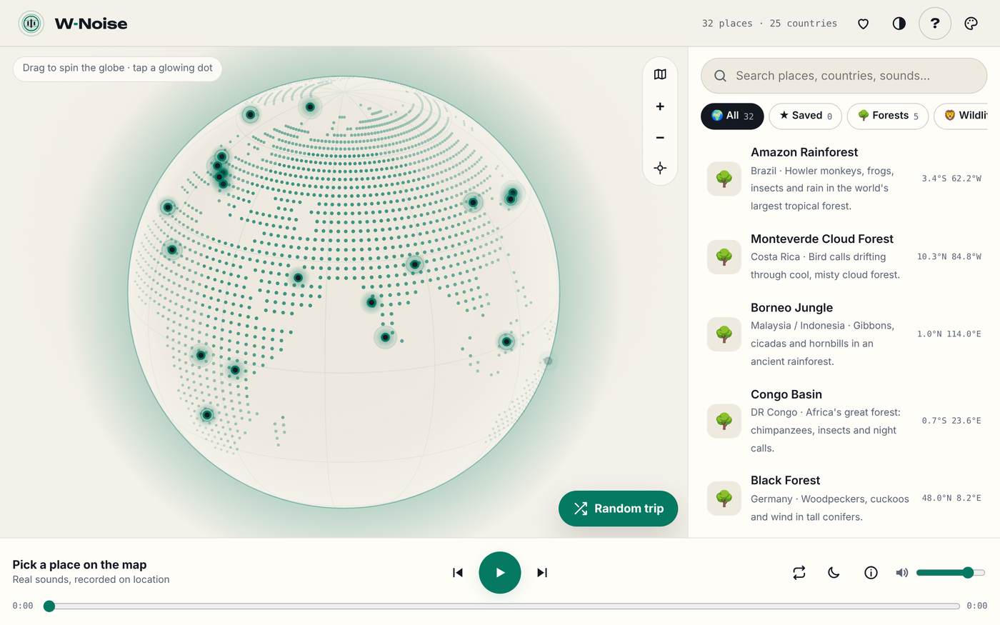
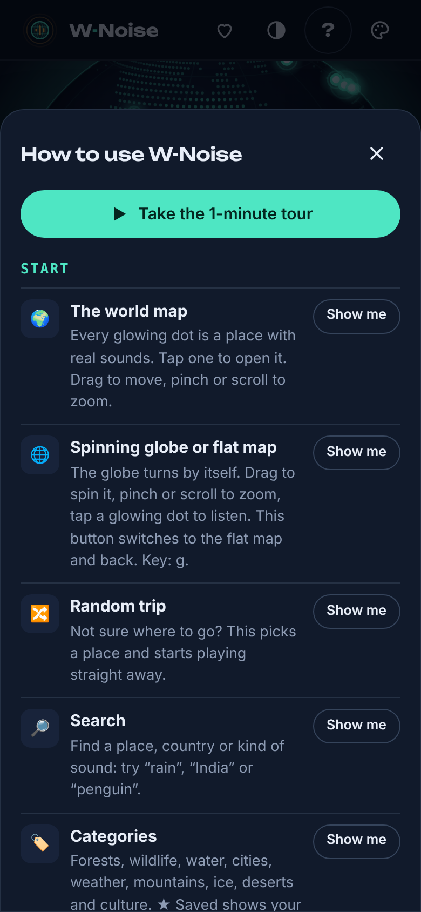
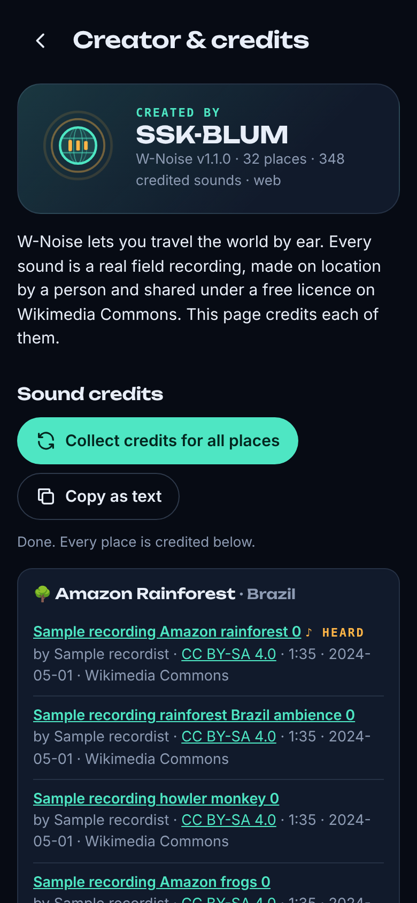
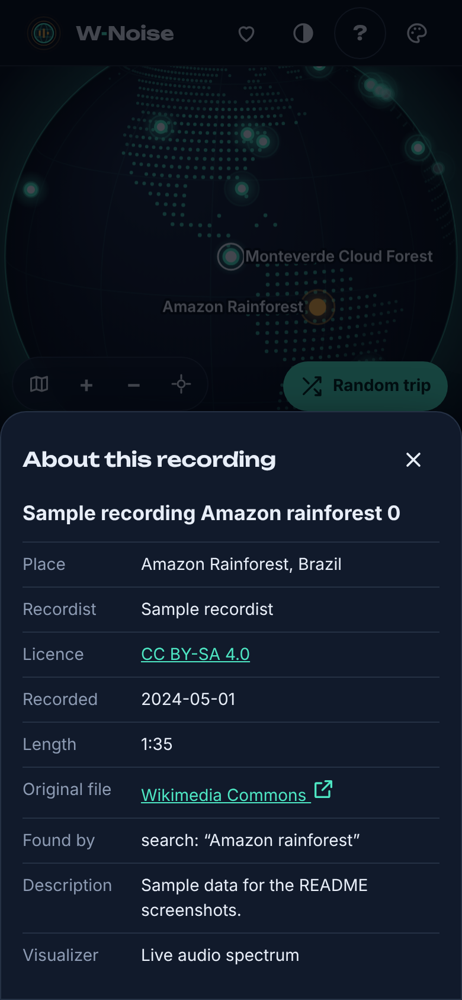
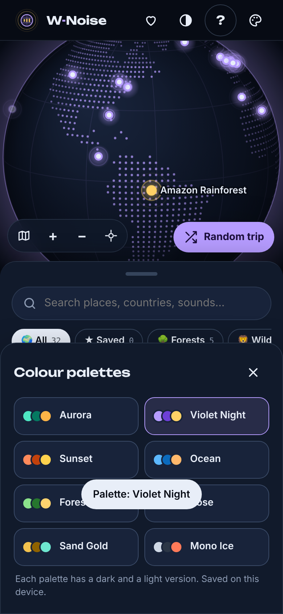
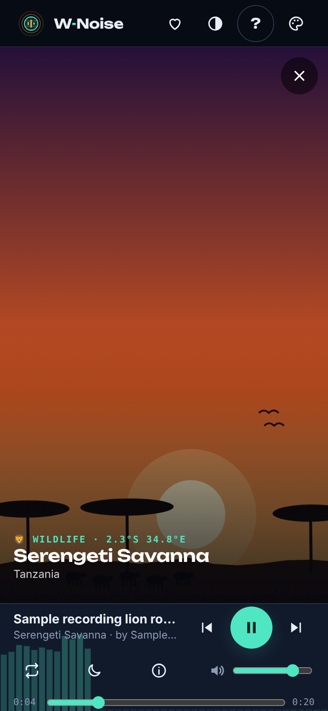
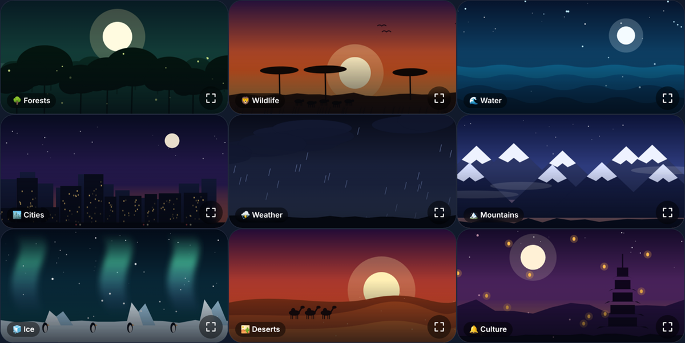

# W-Noise

*Created by **SSK-BLUM***

**Travel the world by ear.** Watch the **spinning globe** and tap a glowing location dot — the Amazon Rainforest, the Serengeti, Kerala in the monsoon, Souq Waqif in Doha, Tokyo, Antarctica — and hear **real field recordings made at that kind of place**, found live on Wikimedia Commons. Every recording is credited to the person who recorded it, and all credits are collected on the **Creator page**.

Installable as an app (PWA), works on phones, tablets and desktops, dark and light mode, no accounts, no API keys, no server.

| Phone, dark | Desktop, light |
|---|---|
|  |  |

| How to use | Creator & credits | Recording credit | Colour palettes |
|---|---|---|---|
|  |  |  |  |

> Screenshots use sample data.

## Features

**Map and places**
- **Spinning 3D globe** with glowing location dots for 32 places in 25 countries; it turns by itself, drag to spin, pinch or scroll to zoom, and it turns to the place you pick
- One tap switches to a **flat dotted world map** and back (key `g`)
- Categories: Forests, Wildlife, Water, Cities, Weather, Mountains, Ice, Deserts, Culture, plus ★ Saved
- Search by place, country or sound ("rain", "penguin", "India")
- **Random trip** picks a place and starts playing

**Real sounds, fully credited**
- Recordings are searched on **Wikimedia Commons** with several words per place, mixed so you get variety (rain, frogs, monkeys…)
- Only free-licensed audio (CC0, public domain, CC BY, CC BY-SA…); pronunciation and spoken-word files are filtered out
- Each recording shows its recordist, licence, length and a link to the original file
- **Creator page**: Created by SSK-BLUM, plus credits for every recording, grouped by place; collect credits for all places and copy them as text

**Player**
- Play/pause, previous/next, seek, **loop**, **sleep timer** (15–90 min with fade-out), volume
- Live spectrum visualizer, lock-screen controls
- **Place picture**: selecting a place shows an animated scene for it (rainforest mist and fireflies, savanna sunset, waves, city lights, storm, aurora and more) with real, credited Commons photos fading in over it as a slow Ken Burns slideshow. Tap the picture for full screen; the player stays usable below it
- **Animated logo**: a spinning globe with sound rings that turns amber while sound plays

**Everywhere**
- **? How to use**: a guide to every button with **Show me** highlights and a 1-minute tour
- Dark, light or auto theme, plus **8 colour palettes** (Aurora, Violet Night, Sunset, Ocean, Forest, Rose, Sand Gold, Mono Ice) from the 🎨 button after **?**; each has a dark and a light version and is remembered
- **Screen mode** button before **?**: Auto, Mobile, Tab or Web forces that layout (a centred phone or tablet column on a wider screen); remembered, key `v`
- Mobile-first layout with a resizable map and bottom sheet; wide layout on tablets and desktops
- Installable PWA with offline app shell and shortcuts (Random trip, Creator)
- Keyboard: Space, `n`, `r`, `g`, `v`, `/`, `?`, Esc

### Place pictures





## Free services used

| What | Service | Key needed |
|---|---|---|
| Place photos and credits | Same Wikimedia Commons API (free-licensed photos only, credited on the Creator page) | No |
| Sound recordings and credits | [Wikimedia Commons](https://commons.wikimedia.org) via the [MediaWiki API](https://commons.wikimedia.org/w/api.php) | No |
| World map | [Natural Earth](https://www.naturalearthdata.com) land (public domain) via [world-atlas](https://github.com/topojson/world-atlas), pre-built into `map-data.js` | No |
| Fonts | Unbounded, DM Sans, JetBrains Mono (Google Fonts) | No |

## Run locally

Any static file server works. Use `localhost` or HTTPS for the PWA features.

```bash
git clone https://github.com/<your-username>/w-noise.git
cd w-noise
python3 -m http.server 8080
# open http://localhost:8080
```

## Build one HTML file (optional)

```bash
node tools/build-single.mjs      # writes dist/w-noise.html (CSS, scripts and places inlined)
```

The single file needs an internet connection for sounds and fonts, and cannot be installed as a PWA (that needs the full repo).

## Publish on GitHub Pages

This repo includes `.github/workflows/pages.yml`, which publishes the site on every push to `main`.

1. Push this repository to GitHub.
2. In the repository, open **Settings → Pages**.
3. Under **Build and deployment → Source**, choose **GitHub Actions**.
4. Push any commit (or re-run the workflow from the **Actions** tab).

Your app will be live at `https://<your-username>.github.io/w-noise/`. Open it on your phone and choose **Install** or **Add to Home Screen**.

## Notes and limits

- **Recordings are found by search words**, so a few may be loosely related to the place. Hand-pick the best files by adding their Commons titles to `pins` in `data/places.json`.
- **Sound needs a connection.** Lists of recordings (with credits) are kept on the device for 7 days.
- **iPhone** plays Commons' MP3 versions; files without one are skipped automatically.
- Recordings belong to their recordists and keep their own licences. W-Noise streams them from Wikimedia and links to every original file page.

For how everything works inside, see **[PROJECT.md](PROJECT.md)**.

## Project structure

```
index.html            markup: header + animated logo, map, panel, player, Creator page, dialogs
styles.css            tokens, dark/light themes, logo animation, layouts, components
app.js                UI: map, list, place view, player, visualizer, Creator page, help/tour, PWA
sounds.js             Wikimedia Commons search, filters, credits and cache
photos.js             Wikimedia Commons place photos, filters, credits and cache
map-data.js           generated dotted world map
data/places.json      the 32 places and their search words
sw.js                 service worker (offline app shell)
manifest.webmanifest  PWA manifest
tools/build-map.mjs   rebuilds map-data.js
tools/build-single.mjs builds the whole app as one HTML file (dist/w-noise.html)
icons/                app icons
docs/screenshots/     README images
CHANGELOG.md          what changed in each version
PROJECT.md            full guide: how everything works, structure, extending, testing
CLAUDE.md             short rules for coding agents
```

## License

[MIT](LICENSE) © SSK-BLUM. Sound recordings are not part of this repository and keep their own licences.
